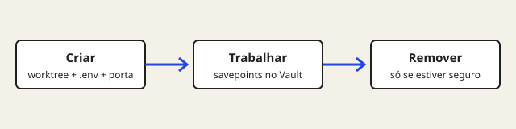

# Fluxo de worktrees

Uma tarefa por worktree; o repo principal fica livre para o que estiver rodando.

1. **Criar** no painel: worktree, `.env` copiado, porta do Docker reservada.
2. **Trabalhar** e gravar savepoints com `worktree:` ou `branch:` no frontmatter.
3. **Remover** só quando não houver alteração nem commit fora do remoto.

Anexos que o leitor sabe mostrar:

[Checklist de remoção](../assets/checklist-remocao.pdf)

- [Faixa de portas por repo](../assets/portas.csv)
- [Arquivo que não existe](../assets/nao-existe.pdf)

Links para outras notas continuam navegando: [[worktree-app/docs/kanbans/checkout]].
